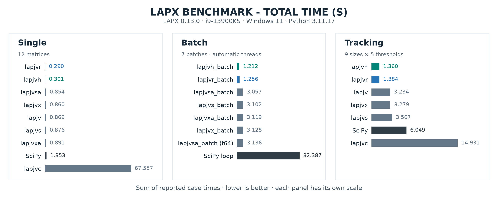

<details><summary>🆕 What's new</summary><hr>

> <sup>- 2026/10/29: [v0.13.0](https://github.com/rathaROG/lapx/releases/tag/v0.13.0) improved performance on rectangular inputs for native R/H families. </sup><br>
> <sup>- 2026/10/27: [v0.12.0](https://github.com/rathaROG/lapx/releases/tag/v0.12.0) improved performance on congested rectangular inputs for native R/H families. </sup><br>
> <sup>- 2026/10/19: [v0.11.0rc1](https://github.com/rathaROG/lapx/releases/tag/v0.11.0rc1) added the Rust and hybrid solvers: **`lapjvr`**, **`lapjvh`**, **`lapjvr_batch`**, and **`lapjvh_batch`**. </sup><br>
> <sup>- 2026/09/07: [v0.10.0rc1](https://github.com/rathaROG/lapx/releases/tag/v0.10.0rc1) added Python 3.15 support and **`lapmod_batch`**. It improved type hints, stability, and performance. </sup><br>

</details>

---

<div align="center">

[](https://github.com/rathaROG/lapx/releases)
[](https://pypi.org/project/lapx/#files)
[](https://pypi.org/project/lapx/)

# Linear Assignment Problem Solvers · 𝕏

**Single ✓ Batch ✓ Square ✓ Rectangular ✓**

</div>

[`lapx`](https://github.com/rathaROG/lapx) started as a project to maintain Tomas Kazmar's [`lap`](https://github.com/gatagat/lap), a Jonker-Volgenant solver package.
It provides dense and sparse solvers for single matrices and batches.
See the [usage guide](https://github.com/rathaROG/lapx/blob/main/USAGE.md) for all available functions.

For dedicated native solvers, see [laprust](https://github.com/rathaROG/laprust)
(Rust, from `lapjvr`) and [lapcpp](https://github.com/rathaROG/lapcpp) (C++).
Both packages provide `lapjv` and `lapjv_batch`.

## 💽 Installation

### Install from [PyPI](https://pypi.org/project/lapx/):

[](https://pypi.org/project/lapx/)
[](https://badge.fury.io/py/lapx)
[](https://pepy.tech/projects/lapx)
[](https://pepy.tech/projects/lapx)

```bash
python -m pip install lapx
```

Published wheels cover Python 3.9–3.15 on most platforms and architectures. See the [package files](https://pypi.org/project/lapx/#files) for details.
musllinux ARMv7 wheels include all pre-existing solvers but omit `lapjvr`, `lapjvh`,
`lapjvr_batch`, and `lapjvh_batch` because native Rust build tools are unavailable.

For source builds, optional solver families, and compiler settings, see the
[installation guide](https://github.com/rathaROG/lapx/blob/main/INSTALLATION.md).

## 🧪 Usage

Install the package as `lapx` and use `import lap`.
Do not install `lap` and `lapx` together. Both packages provide the import name `lap`.

See the [usage guide](https://github.com/rathaROG/lapx/blob/main/USAGE.md) for
[single-matrix examples](https://github.com/rathaROG/lapx/blob/main/USAGE.md#single-matrix-solvers),
[batch examples](https://github.com/rathaROG/lapx/blob/main/USAGE.md#batch-solvers),
[cost rules](https://github.com/rathaROG/lapx/blob/main/USAGE.md#cost-values), and return formats.

## 🏆 Benchmark and Test

[](https://github.com/rathaROG/lapx/blob/main/benchmark.md#summary-figure)

Totals sum the recorded case times with the original precision settings.

See the [benchmark guide](https://github.com/rathaROG/lapx/blob/main/benchmark.md) for commands, repeat controls, timing methods, and historical results.

See the [solver test guide](https://github.com/rathaROG/lapx/tree/main/tests) and the
[build and packaging guide](https://github.com/rathaROG/lapx/tree/main/.github/tests) to run the checks.

## 📝 License

[](https://github.com/rathaROG/lapx/blob/main/NOTICE)
[](https://github.com/rathaROG/lapx/blob/main/LICENSE)
